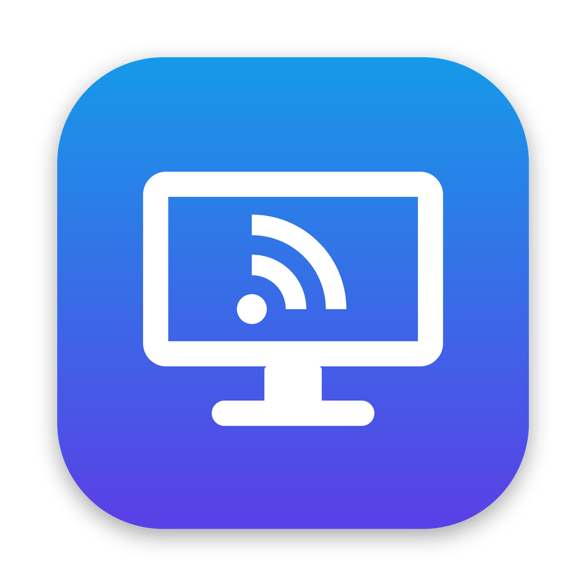

<p align="center"></p>

# rdOO

Cliente RDP ultraligero para macOS, en Rust.

- Al abrir la app (o pulsar su icono del Dock) aparece la lista de equipos: elegir y conectar.
- Clic derecho en el icono del Dock o icono en la barra de menú: misma lista.
- **Usuarios reutilizables**: un mismo usuario/contraseña para varias conexiones (pestaña «Usuarios» del editor).
- **Editor visual** de conexiones (menú «Conexiones…»): añadir, duplicar, ordenar y configurar sin tocar el archivo.
- La versión se ve en la barra de menú, en «Acerca de rdOO» y en el editor.
- Icono de la app: `assets/icon.png` (el `.icns` se genera en `scripts/bundle.sh`).
- Lista en **iCloud Drive** (`iCloud Drive/rdOO/hosts.toml`), sincronizada entre Macs y recargada automáticamente al cambiar.
- Contraseñas en el **Llavero de macOS** (servicio `rdOO`), nunca en iCloud ni en el archivo.
- **Portapapeles de texto** compartido Mac ⇄ Windows, y **Cmd actúa como Ctrl** en el remoto (Cmd+C/V/X/Z/A como en el Mac).
- Motor RDP: [`ironrdp-viewer`](https://github.com/Devolutions/IronRDP) (IronRDP, MIT/Apache-2.0) con H.264/AVC444 vía OpenH264, NLA/CredSSP, portapapeles y audio.

## Estructura

```
src/main.rs      barra de menú (tray-icon + muda + tao), vigilancia del archivo (notify)
src/config.rs    hosts.toml (ubicación iCloud / fallback ~/.config/rdoo)
src/keychain.rs  Llavero (security-framework)
src/launch.rs    lanza ironrdp-viewer con la contraseña por variable de entorno
src/ui.rs        diálogos nativos vía osascript
src/editor.rs    editor visual (tao + wry/WKWebView), interfaz en src/editor.html
src/dock.rs      menú del clic derecho en el Dock
scripts/bundle.sh  compila todo y genera dist/rdOO.app
vendor/IronRDP   IronRDP (lo descarga bundle.sh, versión fijada; no está en el repo)
patches/         parche propio sobre IronRDP (bundle.sh lo aplica):
                 - redimensionado dinámico con EGFX sin reconectar
                 - título de ventana y tamaño inicial en puntos (Retina)
                 - log de peticiones de redimensionado
                 - portapapeles de texto en macOS (NSPasteboard ⇄ CLIPRDR)
                 - Cmd como Ctrl (RDOO_CMD_AS_CTRL)
```

## Compilar e instalar

Requisitos: macOS 11+, Rust (`rustup`), Xcode Command Line Tools y cmake
(`python3 -m pip install --user cmake` o `brew install cmake`).

```sh
git clone <este repo> rdOO && cd rdOO
scripts/bundle.sh --install
open ~/Applications/rdOO.app
```

La primera vez `bundle.sh` descarga IronRDP en `vendor/`, aplica `patches/` y compila (unos minutos).

Desarrollo (sin bundle, tras un primer `bundle.sh`):

```sh
(cd vendor/IronRDP && cargo build --release -p ironrdp-viewer --features openh264)
cargo run --release
```

## hosts.toml

Se edita desde **Conexiones…** o a mano (menú → **Abrir hosts.toml**).

```toml
[[login]]                     # usuario reutilizable (opcional)
name = "Admin oficina"
user = "administrador"
# domain = "EMPRESA"

[[host]]
name = "Servidor"
address = "srv.example.com"
login = "Admin oficina"       # usa el usuario de arriba y comparte su contraseña

[[host]]
name = "Oficina"
address = "192.168.1.50"      # o "host:3389"
user = "usuario"
# domain = "EMPRESA"
# width = 1280                # tamaño inicial de la ventana, en puntos
# height = 800
# scale = 100                 # escala remota en % (100–500)
# udp = true                  # transporte UDP
# microphone = true           # redirigir micrófono
# local_cursor = true         # cursor local
# no_h264 = true              # modo gráfico antiguo
# no_clipboard = true         # sin portapapeles compartido
# cmd_is_windows = true       # Cmd = tecla Windows (por defecto Cmd = Ctrl)
# args = ["--audio-latency", "200"]   # opciones extra de ironrdp-viewer
```

## Contraseñas

- Se piden la primera vez y se guardan en el Llavero si la conexión funciona.
- Menú → **Olvidar contraseña** para borrarla.
- La cuenta en el Llavero es `usuario@dirección`, o `login:<nombre>` si la conexión usa un usuario guardado
  (todas sus conexiones comparten esa contraseña; si renombras el usuario, se pedirá de nuevo).

## Logs

`~/Library/Logs/rdOO/<equipo>.log` (Menú → **Ver logs**).

## Variables de entorno

- `RDOO_CONFIG` — ruta alternativa de `hosts.toml`.
- `RDOO_VIEWER` — ruta alternativa de `ironrdp-viewer`.
- `RDOO_OPEN_EDITOR` — abrir el editor al arrancar.

## Pendiente

- Pantalla completa / multimonitor.
- Ajuste fino del teclado español (Cmd/Ctrl, AltGr).
- Redirección de carpetas.

## Servidor (Windows)

IronRDP no soporta la «Seguridad RDP» antigua (cifrado RC4, sin TLS). Si el servidor está
configurado así, la conexión falla con `FailureCode(2)` (SSL_NOT_ALLOWED_BY_SERVER).
Para activar TLS + NLA, en PowerShell como administrador en el servidor:

```powershell
$k = 'HKLM:\SYSTEM\CurrentControlSet\Control\Terminal Server\WinStations\RDP-Tcp'
Set-ItemProperty $k SecurityLayer 2        # 2 = TLS (1 = Negociar)
Set-ItemProperty $k UserAuthentication 1   # NLA
# Si hay directiva de grupo que lo fuerce:
Get-ItemProperty 'HKLM:\SOFTWARE\Policies\Microsoft\Windows NT\Terminal Services' -ErrorAction SilentlyContinue |
  Select-Object SecurityLayer, UserAuthentication
```

Las sesiones abiertas no se cortan; el cambio aplica a las conexiones nuevas.
